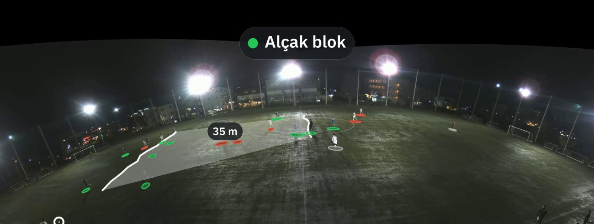

# Otomatik telestrasyon (adım 1)

1 Kasım 2026. Analistin elle çizdiği halka, çizgi ve etiketi sistemin kendisi
çizer. Kod: `app/tracking/telestration.py`, komut: `scripts/telestrate_video.py`,
test: `tests/test_telestration.py`.

## Ne çizer

| Öğe | Kaynak | Not |
|---|---|---|
| Oyuncu halkası | ayak noktasında 0,9 m saha çemberinin izdüşümü | takım rengi; uzakta yatıklaşır |
| Blok çizgileri + şerit | savunan takımın x-boşluk hatları (8 m, ≥3 oyuncu) | hattaki oyuncuların genişliğinde, ±3 m |
| Hatlar arası mesafe | iki hattın derinlik farkı | "13 m" gibi, şeridin ortasında |
| Pres vurgusu | topa ≤5 m savunanlar (en yakın ≤3 m, ≥2 oyuncu) | halka kırmızı ve kalın |
| Faz etiketi | savunma hattının kendi kalesine uzaklığı: <30 alçak, 30–45 orta, üstü yüksek | savunan takımın renk noktasıyla; ≥1 s kararlıysa değişir |

Savunan takım: karenin `possession_team_external_id` alanının 1 sn çoğunluğu.
Hücum yönü: operatör (`--home-attack x+|x-`) ya da `space_map.infer_attack_direction`.

## Neden takip hattının dışında

`app/tracking/pipeline.py` ve `scripts/track_video.py` birleşik kimlik kontrolü
için dondurulmuştur (`docs/measurements/joint-identity-frozen-decision.json`).
Telestrasyon takip çıktısını (`TrackingFrame`, saha koordinatı) okur ve her öğeyi
saha uzayından görüntüye geri izdüşürür. Bu yüzden dondurmaya dokunmaz. Aynı
çizim öğeleri `--marks-json` ile kare başına yazılır; canlı panel katmanı bunları
kullanabilir.

## İzdüşüm ve güven kapıları

- Homografi: kapalı biçimde ters; ufkun arkasına düşen nokta reddedilir.
- TPS: ileri modelin sayısal tersi (homografi tersinden Gauss-Newton). İleri
  dönüşümle 0,1 m içinde doğrulanmayan nokta reddedilir. Yalnız destek bölgesinde
  çizilir: işaretli saha sınırı, yoksa kontrol noktalarının görüntüdeki dışbükey
  zarfı. Zarf dışı ekstrapolasyondur; gece kaydındaki top hatası buradan doğmuştu
  (`docs/TOP-SINIR-UYUSMAZLIGI-TANI.md`). Destek dışındaki top ve oyuncu sayılmaz.
- Çizgi ve etiket yalnız şu koşullarda: kalibrasyon bağımsız doğrulanmış ve
  hatası ≤2,0 m (`calibration_validation`: meta'daki çizgi doğrulaması ya da
  noktalarının ≥%80'i saha işareti üzerinde olan kalibrasyonun LOO'su; oyuncudan
  türetilmiş ya da yapay noktalı kalibrasyon "doğrulanmamış"), sahiplik
  biliniyor, yön biliniyor, savunan takımdan ≥6 oyuncu görünür. Her kare için
  çizilmeme nedeni `gate_counts` içinde sayılır. (İlk sürümde kapı kalibrasyonun
  kendi noktalarındaki LOO ≤1,5 m idi; bu bölümdeki ölçümler o kapıyla alındı.
  Değişikliğin nedeni: `docs/TESPIT-KALITESI-DENETIMI.md`.)

## Ölçüm: SoccerTrack v2 117092, ilk 30 sn (gece, sabit panoramik kamera)

Takip: `track_video --camera static --weights data/tracking/models/rfdetr_mixed_small --tiles 4 --max-seconds 30`.
Kalibrasyon: TPS, 500 nokta, LOO 0,76 m (köşeler işaretli değil → dışbükey zarf).

| Yön | Çizilen kare | Kapı dağılımı |
|---|---:|---|
| otomatik (`auto`) | 1 / 126 (%1) | possession 3, direction 87, players 35, drawn 1 — iki kaleci de çoğunlukla görünmüyor |
| operatör (`x+`) | 68 / 126 (%54) | possession 3, players 55, drawn 68 |

`players` kapısı takım atamasının dengesizliğinden gelir (karede ortalama 9,5'e
6,1 atanmış oyuncu). Eşikler bu klibe bakılarak gevşetilmedi. Çizim hızı aşağıda (25 fps bölümü).

Görsel denetim (4 kare): top ev sahibi kalesi önündeyken "Alçak blok" (yeşil),
top ortadayken deplasman "Yüksek blok" — oyun durumuyla tutarlı. Etiket doğruluğu
etiketli maçla **ölçülmedi**; bu bir görsel kontroldür.

## Doğruluk: saha gerçeğiyle karşılaştırma (SoccerTrack v2 GSR)

`scripts/soccertrack_v2/eval_telestration.py`, rapor
`docs/measurements/telestration-eval-117092.json`. Girdi: canlı mod koşusunun
12 segmenti (`data/tracking/live/990401/frames`, dk 10–16, 1500 kare). Aynı
`Telestrator` üç girdiyle çalışır: GSR konum + takım (referans), takip çıktısı,
takip konumu + eşleşen GT takımı (≤3 m Macar eşlemesi). Sahiplik üçünde de
takip karesinden, hücum yönü GT kalecilerinden gelir; yani sahiplik ve yön
**ölçülmez**. Hizalama geliştirme segmentlerinde sabitlenmiş kaydırmadır; eşikler
bu veriye bakılarak ayarlanmadı.

| 1500 kare | Çizilen | Blok etiketi = GT | Taban (hep en sık) | Dengeli doğruluk | Savunma hattı hatası medyan / p90 |
|---|---:|---:|---:|---:|---:|
| GT konum + GT takım | %99,8 | — | — | — | — |
| **takip (üretim)** | %78,6 | %75,8 | %68,6 | **%71,3** | 6,1 / 25,1 m |

GT etiketlerinin %69'u "Yüksek blok"; ham isabet tabanın yalnız 7,2 puan üstündedir.
Dengeli doğruluk (sınıf başına duyarlılık ortalaması, sabit tahmin = %33,3)
%71,3'tür: alçak %75, orta %57, yüksek %82.

Hata kaynağı, üç koşunun da çizdiği aynı 360 karede:

| aynı 360 kare | Blok = GT | Dengeli | Hat hatası medyan / p90 |
|---|---:|---:|---:|
| takip | %81,4 | %67,6 | 4,4 / 14,0 m |
| takip konumu + doğru takım | %94,9 | %74,5 | 3,3 / 14,9 m |

Takım ataması bu kayıtta %77 doğru (11739 eşleşmenin 9065'i). Düzeltilirse
dengeli doğrulukta ~7 puan ve hatta ~1 m kazanç var; kalan p90 hatası
tespit/konumdan (karede ortalama 8,5 oyuncu GT ile eşleşiyor). Doğru takımlı
koşu yalnız %25,5 karede çizer, çünkü eşleşmeyen oyuncular takımsız kalır ve
savunan takımda 6 oyuncu bulunamaz; bu yüzden karşılaştırma aynı karelerde yapılır.

## 25 fps enterpolasyon

`telestrate_video` varsayılan olarak kaynak kare hızında yazar: takip kareleri
arasında oyuncular kimliğe göre doğrusal enterpole edilir (kamera kesmesinde ve
0,6 sn'den uzun boşlukta yapılmaz). Hat yumuşatması zamana bağlıdır (0,2 sn'de
yeni değerin payı 0,35), kare hızı değişince davranış değişmez.

Ölçüm (aynı rapor, `interpolation`): takip kareleri arasındaki GT karelerinde,
iki karede de bulunan oyuncular için eşleşme hatası medyanı **son kareyi tutma
1,959 m → enterpolasyon 1,952 m** (~60 bin eşleşme). Kazanç görsel akıcılıktır,
doğruluk değil: hata tespit/kalibrasyon tabanından (~1,9 m) gelir; 0,24 sn'lik
aralıkta oyuncunun yer değiştirmesi bunun yanında küçüktür.

Hız: 30 sn 4K kaynak 25 fps'te 31 sn'de çizilir (~4 sn'si tek seferlik açılış:
importlar ve TPS kalibrasyonunun LOO hatası). Kare başına ~11 ms çözme, ~3 ms
küçültme, ~21 ms çizim öğesi hesabı, ~3 ms çizim. İlk sürüm 4K karede ve oyuncu
başına ayrı TPS tersiyle gerçek zamanın ~3 katıydı; çizim artık çıktı boyutunda,
halkalar tek toplu ters dönüşüm + merkezde yerel Jacobian ile (tam izdüşümden
<0,5 px fark, `test_batched_rings_match_exact_projection`).

## Dayanıklılık denemesi: çizim katmanında düzeltilemiyor

Takım ataması deneyleri (`docs/TAKIM-CAPA-DENEYI-SONUCLARI.md`) kalıcı kazanç
getirmeyince, telestrasyonun kendisini gürültüye dayanıklı yapmak denendi.

Teşhis (geliştirme 600–960 sn, savunma hattı hem takipte hem GT'de çizilen 1179
kare): savunan takım sayılan ~10 oyuncunun 4,3–5,6'sı GT'de 3 m içinde karşılık
bulmuyor (hayalet tespit ya da konumu sapmış); yanlış takımlı oyuncu ise hatası
küçük ve büyük (>8 m) karelerde aynı (1,1 / 1,3; en geri 4'te 0,46 / 0,47).
Büyük hat hatasını ayıran takım ataması değil, karşılıksız tespitlerdir.

`TelestrationConfig` (varsayılanlar üretim davranışı) ile geliştirmede taranan
adaylar (`eval_telestration --config-json`):

| Ayar | Çizilen | Blok = GT | Dengeli | Hat hatası medyan / p90 |
|---|---:|---:|---:|---:|
| üretim | 1179 | %75,8 | %71,3 | 6,1 / 25,1 m |
| kısa ömürlü tespit dışarıda, 0,5 / 1 / 2 sn | 1106 / 970 / 719 | %73,5 / 70,7 / 72,2 | %68,1 / 61,1 / 65,6 | 6,1–7,3 / 25,3–26,1 m |
| hat derinliği medyan | 1179 | %75,6 | %71,2 | 6,1 / 25,9 m |
| hat yumuşatması 0,15 | 1179 | %76,0 | %71,6 | 6,1 / 24,6 m |

Etiket kararlılığı 2 sn ilk bakışta %78,0 dengeli verdi, ama bu ayar GT
referansına da uygulanmıştı: referansın tanımı değişince uyum yapay olarak
artar. Referans sabit (1 sn) tutulunca (`--reference-default`) 2 sn %64,2,
3 sn %45,5 verdi — zararlı. Hiçbir aday geliştirmede anlamlı kazanç göstermediği
için kontrol dilimine gidilmedi; üretim varsayılanları değişmedi. Hayalet ve
sapmış tespiti çizim katmanı ayıramıyor: kısa ömürlü tespitleri atmak gerçek
oyuncuları da attı (çizilen kare düştü, doğruluk artmadı).

## Bağımsız tekrar: görülmemiş dilim, güncel kod

`docs/measurements/telestration-eval-117092-1200.json`. 1200–1560 sn
(`scripts/soccertrack_v2/cut_segments.py` ile kesilen `data/tracking/live/990402`),
bugünkü `track_video` ile canlı işçi gibi segment segment takip edildi (ilk
segmentin takım renkleri çapa); bu dilim daha önce hiçbir telestrasyon kararında
kullanılmadı. Üretim varsayılanları.

| | 600–960 (eski kod) | 1200–1560 (güncel kod) |
|---|---:|---:|
| Çizilen kare | %78,6 | %50,9 |
| Blok = GT (taban) | %75,8 (%68,6) | %81,8 (%64,3) |
| Dengeli doğruluk | %71,3 | %74,9 |
| Savunma hattı hatası medyan / p90 | 6,1 / 25,1 m | 6,0 / 25,9 m |
| Takım ataması (eşleşen) | %77 | %72 |
| Karede GT ile eşleşen oyuncu | 8,5 | 5,4 |

Etiket doğruluğu ve hat hatası tekrarlandı. Çizilen kare oranı, karede daha az
oyuncu eşleştiği için düştü: kapılar (savunan takımda ≥6 oyuncu) daha sık devreye
girdi. Bu dilimde üç koşunun da çizdiği yalnız 119 kare olduğundan takım ataması
ayrıştırması güvenilir değildir ve rapor edilmez.

## Canlı mod bağlantısı

`scripts/telestrate_live.py` canlı modun segment klasörünü izler; `track_live`'ın
bıraktığı her `seg_XXXX.mp4` + `frames/seg_XXXX.json` için `tele/seg_XXXX.mp4`
(H.264, tarayıcıda oynar), `tele/seg_XXXX.marks.json` ve `tele/latest.json` yazar.
Telestratör durumu segmentler arasında korunur. Hata veren segment
`seg_XXXX.error.json` ile kaydedilip atlanır; yarım yazılmış takip JSON'u sonraki
turda yeniden denenir. `canli_mac --telestration --calibration <çizgi noktalı> --home-attack x+`
işçiyi takiple birlikte başlatır ve kaynak bitince kalan segmentleri bekler.
Çizim için `scripts/telestrate_video.py` içindeki `render_segment` ortak kullanılır.

Duman testi (`990402`'nin iki segmenti, eğitim GPU'yu kullanırken): 2 × 30 sn
57 sn'de çizildi (segment başına ~28 sn, gerçek zamana yetişiyor). Panelde bu
videoyu gösteren katman henüz yok.

## Denenen ve bırakılan: topsuz koşu okları

Deneme commit'i `b5ed6a4`, geri alma `e981142`. Topa sahip takımın son 1 sn'de
≥5,5 m/s ve hücum yönüyle ≤~45° koşan oyuncularına ok; ışınlanma (>12 m/s,
kimlik kayması) elenir. Eşikler ölçümden önce sabitlendi. Aynı kural GT
konumlarına uygulandı; ok, aynı karede 3 m içinde bir GT koşusuyla eşleşirse doğru.

| | Çizilen ok | GT koşusu | Eşleşen | Doğru ok | Yakalanan koşu |
|---|---:|---:|---:|---:|---:|
| 600–960 sn (990401) | 331 | 209 | 27 | %8,2 | %12,9 |
| 1200–1560 sn (990402) | 221 | 153 | 3 | %1,4 | %2,0 |

Okların neredeyse tamamı yanlış: ~4 fps'lik konumlarda kalibrasyon hatası ve tespit
titremesi hız tahminini bozuyor, kimlik kaymaları izleri bölüyor. Yanlış çizim hiç
çizim olmamasından kötü olduğu için özellik üretime alınmadı. Önkoşul: daha doğru
konum (kalibrasyon) ve daha uzun ömürlü kimlik.

Not: kalibrasyon kapısı artık oyuncudan türetilmiş 117092 kalibrasyonunu
doğrulanmamış saydığından, bu karelerle ölçüm `eval_telestration --ignore-calibration-gate`
ile yapılır (konumlar karelerde zaten hesaplıdır; ölçüm GT'ye karşı konumdur).

## Denenen ve bırakılan: savunan oyuncu eşiğini düşürmek

Çizilmeyen karelerin çoğunu "players" kapısı kesiyor (savunan takımdan 6'dan az
görünür oyuncu): 600–960 sn'de 331'in 288'i, 1200–1560 sn'de 629'un 591'i. Eşik
(`TelestrationConfig.min_team_players`) ön kayıtla 5 ve 4'e indirildi
(`docs/measurements/telestration-min-players-plan.json`, sonuçlardan önce commit).
Şart: iki pencerede de çizilen kare ≥ +5 puan, dengeli doğruluk en çok −1 puan, hat
hatası medyanı en çok +1 m.

| Eşik | Çizilen (600 / 1200) | Dengeli doğruluk | Hat hatası medyanı |
|---|---|---|---|
| 6 (üretim) | %77,9 / %58,1 | %73,2 / %79,4 | 5,9 / 5,6 m |
| 5 | %80,6 / %61,1 | %73,3 / %79,9 | 6,3 / 5,8 m |
| 4 | %83,1 / %63,0 | %74,1 / %80,2 | 5,9 / 5,6 m |

Doğruluk bozulmadı ama kapsama kazancı şartın altında kaldı (4: +5,2 / **+4,9**).
Üretim 6'da kaldı. Eşik düşünce karelerin çoğu "players" kapısından "lines"
kapısına geçiyor: kapsamayı sınırlayan eşik değil, tespit (GT oyuncularının
yaklaşık yarısı bulunmuyor). Sonuç: `docs/measurements/telestration-min-players-results.json`.

## Sınırlar ve sıradaki adımlar

- Yalnız sabit kalibrasyon. Kare başına kalibrasyonla işlenen hareketli kamera
  karelerin kendi homografisini çıktıya yazmadığı için desteklenmez.
- Blok eşikleri sezgiseldir; etiketli faz verisiyle ayarlanmadı.
- Doğruluğu sınırlayan sırayla: savunan takımdaki karşılıksız tespitler
  (hayalet/sapmış konum), takım ataması, tespit kapsaması. Üçü de takip/tespit
  tarafındadır (dondurulmuş kod); çizim katmanı ayarları bunları telafi etmedi.
- Sırada: panelde canlı telestrasyon videosu (`tele/latest.json`), topsuz koşu
  okları, boşluk boyama.
