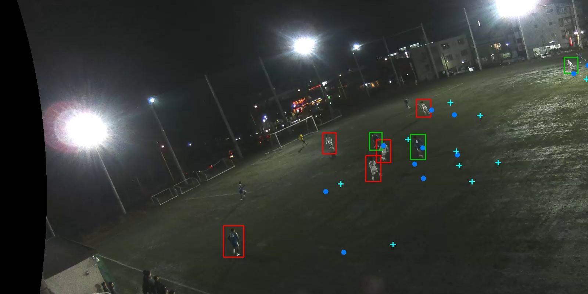
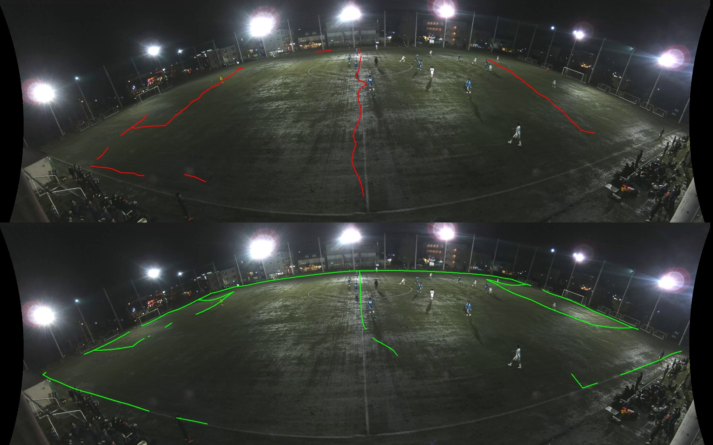

# Tespit kalitesi denetimi ve kalibrasyon bulgusu (SoccerTrack 117092)

1 Kasım 2026. Telestrasyon ölçümünde savunan takımdaki tespitlerin yaklaşık
yarısı GT'de karşılık bulmuyordu (`docs/OTOMATIK-TELESTRASYON.md`). Bu denetim
o tespitleri ayırır. Üretim kodu ve kalibrasyon dosyaları değiştirilmedi.

## Yöntem

`scripts/soccertrack_v2/detection_audit.py`. GSR görüntü kutuları videonun
koordinatında değildir (sabit ~30×32 px, 3840×1504 panorama uzayı); bu yüzden GT
saha konumları kendi kalibrasyonumuzla görüntüye izdüşürülür ve tespit
kutularıyla görüntüde karşılaştırılır. Tespit sınıfları: **iyi** (sahada ≤3 m),
**izdüşüm** (görüntüde bir GT oyuncusunun üstünde ama sahada >3 m), **kopya**,
**hayalet** (görüntüde yakınında GT oyuncusu yok). Veri: `team_tele_v1`
önbelleği (600–960 sn, güncel kod), her 4. örnek, saha oyuncuları.

## Bulgu 1 — sorun coğrafi

| | Pay (20629 tespit) |
|---|---:|
| iyi | %45,9 |
| hayalet | %42,0 |
| izdüşüm (medyan 3,7 m sapma) | %9,9 |
| kopya | %2,2 |
| GT oyuncusu tespit edilme oranı | %51,1 |

Orta üçte bir, kameraya yakın bantlarda hayalet %4–30 ve tespit oranı %61–80;
panoramanın uçlarında ve uzak bantta hayalet %50–94, tespit oranı %7–49
(bölge tablosu: `docs/measurements/detection-audit-117092-600.json`).

## Bulgu 2 — uçlardaki "hayaletlerin" çoğu gerçek oyuncu: kalibrasyon



Kırmızı ("hayalet") kutular görünür biçimde oyunculardır; GT noktaları (mavi)
onlardan yüzlerce piksel uzağa düşer. Saha çizgileri iki kalibrasyonla çizildiğinde:



Üretim kalibrasyonu (`soccertrack_v2_117092.json`, GT oyuncu eşleşmelerinden ve
GSR piksellerinin polinomla taşınmasından kurulmuş) uzak taç çizgisini sahayı
çapraz kesen bir çizgiye, ceza sahalarını yanlış yere koyar. Saha çizgisi
noktalarından kurulan `soccertrack_v2_117092_landmarks.json` boyalı çizgilere
oturur (yakın tarafta küçük sapmalar). Bu, `docs/TOP-SECIMI-SONUCLARI.md`'deki
çizgi ölçümünü (10,71 m'ye karşı 1,76 m) görsel olarak doğrular.

Aynı tespitlerle çizgi kalibrasyonu: uçlarda büyük iyileşme (ör. sağ uzak köşe
tespit oranı %7 → %50, sol uzak köşe hayalet %82 → %25), ortada yakın bantta
kötüleşme (kenardaki kişiler sahanın içine düşer); toplam tespit oranı %51 → %55
(`detection-audit-117092-600-landmarks.json`).

Veri setinin kendi geometri dosyaları kullanılamadı: `117092_homography.npy`
denenen hiçbir görüntü/saha düzeninde tutmadı; `padding_info.csv` indirilememiş
(içinde 404 sayfası); `camera_intrinsics.npz` yalnız pickle izniyle açılıyor ve
güvenlik nedeniyle açılmadı.

## Bulgu 3 — kalibrasyonun telestrasyona etkisi

`scripts/soccertrack_v2/telestration_calibration_compare.py`: aynı piksel
tespitleri ve aynı üretim takım ataması, yalnız kalibrasyon değişir; GT referansı
aynı ayarla. Kalibrasyonlar bu veriye bakılarak seçilmedi.

| | 600–960 üretim | 600–960 çizgi | 1200–1560 üretim | 1200–1560 çizgi |
|---|---:|---:|---:|---:|
| Çizilen kare (/1500) | 1174 | 1146 | 769 | 858 |
| Dengeli blok doğruluğu | %72,2 | %68,8 | %82,1 | %83,0 |
| Savunma hattı hatası medyan | 6,39 m | 5,96 m | 5,73 m | 4,43 m |
| Savunma hattı hatası p90 | 29,1 m | 24,0 m | 20,3 m | 18,9 m |

Çizgi kalibrasyonu savunma hattını iki dilimde de daha doğru konumlar (medyan
0,4–1,3 m, p90 1,4–5,2 m); etiket doğruluğu karışıktır. Sahiplik ve destek
bölgesi kalibrasyona bağlı olduğundan GT koşuları iki kalibrasyonda birebir aynı
değildir; etiket karşılaştırması bu yüzden kesin değildir.

**Kapı sorunu:** telestrasyonun kalibrasyon kapısı (LOO hatası ≤ 1,5 m) çizgi
kalibrasyonunu (LOO 1,76 m) tümüyle kapattı, üretim kalibrasyonunu (LOO 0,76 m)
geçirdi. Oyuncudan türetilmiş kalibrasyonun LOO'su kendi uydurulduğu noktalarda
ölçülür ve çizgi hatasını (10,71 m) yansıtmaz: kapı yanlış ölçütle yanlış
kalibrasyonu ödüllendiriyor. Karşılaştırma `--ignore-calibration-gate` ile yapıldı.

## Dedektör çalışma ayarları — kazanç yok

`scripts/soccertrack_v2/detection_variants.py`: dondurulmuş takip koduna dokunmadan
`collect_observations` farklı `DetectorConfig` ile çağrıldı; geliştirme segmentleri
1, 5, 9 (600–960 sn; kötü ve iyi segment karışık), `detection_audit` saha çizgisi
kalibrasyonuyla. Raporlar: `docs/measurements/detection-variant-*.json`.

| Ayar | GT tespit oranı | Hayalet | Uçlar | Uzak bant (2–3) | Süre / 30 sn |
|---|---:|---:|---:|---:|---:|
| 4 dilim, eşik 0,35 (canlı mod) | %60,7 | %34,1 | %53,9 | %44,2 | 92–102 sn |
| 6 dilim, eşik 0,35 | %61,7 | %36,5 | %51,7 | %42,2 | 181–197 sn |
| 4 dilim, eşik 0,25 | %61,1 | %34,3 | %54,0 | %44,3 | 110–126 sn |
| 8 dilim | — | — | — | — | 8 GB GPU belleğine sığmadı (bellek dolu, kullanım %0, 16 dk'da segment bitmedi; durduruldu) |

Bütün ayarlar ±1 puan içinde; sorunlu bölgeler (uçlar, uzak bant) hiçbirinde
düzelmedi. Daha çok dilim yalnız süreyi ikiye katladı. Kontrol dilimine aday
çıkmadı. Mevcut ayar bile bu makinede (RTX 5060 Laptop, 8 GB) 4K panoramada
gerçek zamanın ~3,3 katı yavaş.

Yorum: kaçırılan oyuncu, oyuncunun görüntüdeki boyutundan (dilim) ya da güven
eşiğinden değil, modelin bu görüntüleri tanımamasından geliyor. Model
`rfdetr_mixed_small` 512 çözünürlükte, 8 epoch, TeamTrack verisiyle eğitildi
(`data/tracking/models/rfdetr_mixed_small/meta.json`); gece panoramasının uçlarındaki
küçük, karanlık, bozulmuş oyuncuları eğitimde görmedi. Sıradaki gerçek kaldıraç
bu tür görüntülerle (SoccerTrack v2 GT'si mevcut) ince ayar; başka maçların
segmentleriyle ayrık kontrol gerekir.

## Sonuç ve sıradaki adımlar

- Bu kamerada üretim kalibrasyonu oyuncu konumlarını uçlarda metrelerce kaydırıyor;
  bu, önceki takım ve telestrasyon ölçümlerinin bir kısmını etkiler. Kazanç
  telestrasyonda beklenenden küçük: asıl darboğaz tespit kapsaması (%51–55).
- Kalibrasyon kapısı LOO yerine bağımsız çizgi doğrulaması kullanmalı (çizgi
  noktaları yoksa kapı "doğrulanmamış" demeli). Ayrı bir değişiklik olarak önerilir.
- Çizgi kalibrasyonunu 117092'nin varsayılanı yapmak önceki dondurulmuş ölçümlerin
  tekrarlanabilirliğini etkiler (dosya yoluyla referans verilirler); ayrı karar.
- Tespit kapsaması dondurulmuş koda dokunmadan sınanabilir: dedektörün dilim
  (`--tiles`) ve çözünürlük (`--resolution`) ayarları çalışma zamanı seçenekleridir;
  bölge bazında bu denetimle ölçülebilir.

## Tekrar üretim

```powershell
venv-cv\Scripts\python.exe -X utf8 -m scripts.soccertrack_v2.detection_audit --cache data/tracking/bench/team_tele_v1 --gt data/tracking/bench/signal_quality_gt.npy --start-seconds 600 --out docs/measurements/detection-audit-117092-600.json
venv-cv\Scripts\python.exe -X utf8 -m scripts.soccertrack_v2.detection_audit --cache data/tracking/bench/team_tele_v1 --gt data/tracking/bench/signal_quality_gt.npy --start-seconds 600 --calibration data/tracking/calibrations/soccertrack_v2_117092_landmarks.json --out docs/measurements/detection-audit-117092-600-landmarks.json
venv-cv\Scripts\python.exe -X utf8 -m scripts.soccertrack_v2.telestration_calibration_compare --cache data/tracking/bench/team_tele_v1 --gt data/tracking/bench/signal_quality_gt.npy --start-seconds 600 --ignore-calibration-gate --out docs/measurements/telestration-calibration-600.json --calibrations data/tracking/calibrations/soccertrack_v2_117092.json data/tracking/calibrations/soccertrack_v2_117092_landmarks.json
```

1200–1560 için `--cache data/tracking/bench/team_tele_ctrl_v1 --gt data/tracking/bench/team_ctrl_gt.npy --start-seconds 1200`.
Önbellekler `cache_observations` ile (`team_tele_ctrl_v1` için önce `cut_segments --start-seconds 1200`)
yeniden üretilir; git'e alınmaz.
